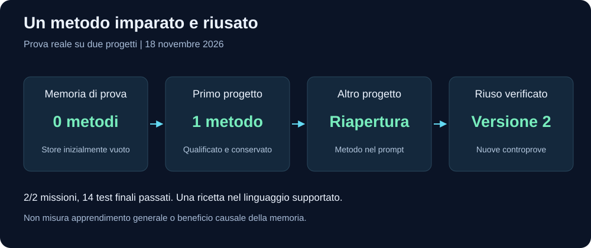
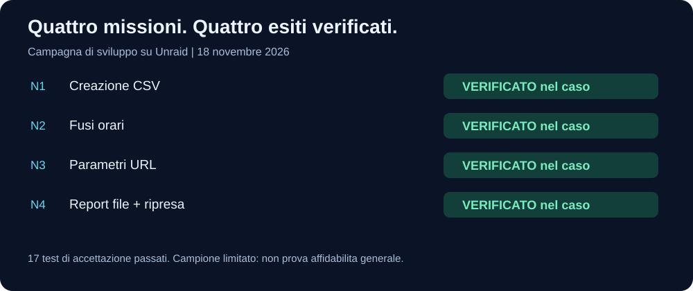

# CodeN Generation

### Dalla richiesta al risultato verificato.

Un progetto AI in sviluppo per cercare informazioni, creare soluzioni, verificarle e conservare esperienze.

**Prototipo proprietario · Sviluppo privato · Vetrina pubblica**

[Capacita e stato](docs/STATO.md) · [Tecnologie](docs/TECNOLOGIE.md) · [Risultati e metodo](docs/METODOLOGIA.md) · [Roadmap](docs/ROADMAP.md)

## Cosa vuole diventare

Un ambiente di lavoro per PC e server che comprende un obiettivo, organizza il lavoro, cerca informazioni, crea, verifica e corregge entro i limiti scelti dall'utente. Modelli e risorse devono essere sostituibili in base al dispositivo e alle esigenze. L'obiettivo comprende memoria di progetto e riuso delle esperienze, oltre la cronologia di una chat.

## Cosa funziona oggi

- **Creazione e riparazione:** programmi creati da zero e bug corretti su missioni controllate.
- **Ricerca documentale e semantica:** fonti pubbliche autorizzate, con embedding locali reali e provenienza registrata.
- **Verifica isolata:** candidati eseguiti in container separati senza rete, con test protetti.
- **Ripresa del lavoro:** una missione ripresa in un nuovo processo conservando candidato, contatori e budget.
- **Memoria persistente:** esiti salvati in uno store autenticato e riaperto fra processi.
- **Riuso condizionato di un metodo:** nuovo metodo acquisito e riapplicato su un altro progetto nella prova reale descritta sotto.

Sono capacita osservate nel perimetro delle prove, non una garanzia per qualsiasi richiesta.

## Nuova prova reale: un metodo imparato e riusato — 18 novembre 2026

**VERIFICATO in una prova controllata: 2 progetti su 2, 14 test finali passati.**

| Passaggio | Risultato osservato |
|---|---|
| Primo progetto | Il modello corregge una routine JSON; MIRA ricava e qualifica un nuovo metodo |
| Memoria | Il metodo viene cifrato e conservato; un nuovo processo riapre lo store |
| Secondo progetto | Il modello riceve il metodo prima della prima scrittura e corregge una routine diversa |
| Nuova verifica | Test separati e controprove passano; il metodo conserva la prima esperienza e aggiunge la seconda, come versione 2 |

Modello locale reale, ricerca su documentazione ufficiale, embedding reali e verifica isolata erano attivi. La memoria di prova era inizialmente vuota. Input e criteri erano congelati prima della generazione; un tentativo per missione. Il valutatore con i test nascosti e rimasto separato fino alla chiusura della generazione.

**Limite:** una ricetta parametrica nel linguaggio supportato, su due piccole routine JSON. Non dimostra apprendimento generale, addestramento dei pesi o un vantaggio causale della memoria. Il secondo compito ha usato piu tempo e token: questi compiti diversi non sono un confronto controllato di efficienza.

71.940 token e 10 chiamate per le missioni; 105 token e 1 chiamata per il controllo iniziale di decodifica. Totale: **72.045 token, 11 chiamate generative**, piu 18 richieste HTTP di embedding. Tempo sommato delle missioni: **11 min 50 s**, esclusi preparazione e valutazione. Token del backend locale, non una spesa API in euro.

Prova su Unraid: almeno 18,57 GiB di RAM host disponibili, 2,08 GiB di VRAM libera, temperatura GPU massima 66,56 C nei campioni delle missioni. Valori dell'host, non consumo esclusivo del prodotto. Windows usato per orchestrazione leggera; nessuna inferenza o suite completa Windows. [Dati selezionati](results/metodi-2026-11-18.json).

## Campagna precedente di creazione, riparazione e ripresa — 18 novembre 2026

**4 missioni su 4 hanno raggiunto i criteri congelati.** Il valutatore separato ha eseguito 17 test di accettazione, tutti passati.

| Missione | Risultato osservato |
|---|---|
| Creazione | Programma per sommare importi CSV e relativa documentazione |
| Riparazione | Gestione corretta dei fusi orari ISO8601 nei casi verificati |
| Riparazione | Parametri URL ripetuti e codifica nei casi verificati |
| Creazione e ripresa | Report dei file, con prosecuzione in un nuovo processo |

Ricerca su documentazione autorizzata, embedding reali e verifica isolata erano attivi. Generazione e valutazione sono rimaste separate. Nessuna ripetizione selettiva delle missioni.

**4/4 non significa affidabilita generale del 100%.** Le missioni sono piccole e controllate. La precedente campagna 3/4 resta registrata come FALLITA; i casi sono diversi e non consentono un confronto diretto di miglioramento.

## Tempi, token e risorse

I token indicano consumo del backend locale, non spesa API in euro. Le durate comprendono ricerca, elaborazione e verifiche della missione; non l'intera preparazione della campagna.

Prova su Unraid/Linux con GPU NVIDIA RTX 3060, modello generativo locale ed embedding locale. Windows usato per orchestrazione leggera; nessuna inferenza o suite completa su Windows. Le misure dell'host comprendono anche altri processi e non rappresentano il consumo esclusivo di CodeN.

## Memoria: cosa e dimostrato

Questa campagna ha conservato **4 osservazioni di esito verificato e 1 ipotesi esplicitamente non verificata**. Lo store e stato riaperto e autenticato. **Nessun nuovo metodo qualificato** e stato prodotto da queste famiglie di compiti.

Il riuso di un metodo era stato osservato in una prova precedente nella sola famiglia dei default mutabili. La nuova prova reale sopra documenta un metodo acquisito e riusato. Generalizzazione e beneficio causale della memoria restano NON MISURATI. Salvare un'esperienza non equivale ad addestrare i pesi di un modello.

## Metodi nuovi: verifica successiva offline

Dopo quella campagna, il prototipo ha acquisito e riapplicato ricette parametriche in due nuove famiglie di casi controllati. La memoria cifrata e stata chiusa e riaperta; i metodi recuperati hanno prodotto correzioni su codice diverso, nuovamente verificate. Non sono soltanto osservazioni archiviate.

**VERIFICATO offline con attori controllati:** 13 nuovi controlli; suite finale 665 test, 664 passati, 0 fallimenti, 0 errori, 1 skip motivato. Revisione separata di Code e correzione dei rilievi. Al momento di questa prova offline il trasferimento con modello reale non era ancora misurato; la prova successiva sopra lo ha osservato in un caso circoscritto. Apprendimento generale e beneficio causale restano NON MISURATI. La campagna reale 4/4 e i suoi grafici restano invariati.

## Cosa resta da costruire e misurare

- Apprendimento e trasferimento di metodi su famiglie generali di problemi.
- Affidabilita su missioni complesse e su ricerca web aperta.
- Autonomia prolungata, pianificazione continua e orchestrazione distribuita.
- Interfaccia grafica completa e distribuzione finale su PC e server.
- Componenti proprietari appresi e vantaggi misurabili su prove indipendenti.

Brain, MIRA, JEC e Agenti Evolutivi hanno ruoli e livelli di maturita diversi: [stato delle tecnologie](docs/TECNOLOGIE.md). Non presentiamo il progetto come AGI.

## Trasparenza e disponibilita

Questa e una vetrina documentale: **non contiene il codice del prodotto, modelli, eseguibili o pacchetti di installazione**. Il software e sviluppato privatamente e non e distribuito qui. Le immagini e i grafici sono materiali di presentazione.

Le evidenze originali sono conservate privatamente. Pubblichiamo [riepiloghi e dati selezionati](results/campagna-2026-11-18.json), [dati delle missioni](results/missioni-2026-11-18.csv) e [serie delle risorse](results/risorse-2026-11-18.csv). I risultati pubblici non costituiscono una riproduzione indipendente del software privato. Dopo la campagna sono stati corretti altri rilievi del circuito di recupero e della ripresa: 652 test offline passati (uno skip) e rilettura Code senza nuovi blocchi individuati nel delta. Gli stessi sorgenti Python del blocco offline a 665 test sono stati poi usati nella nuova prova reale di acquisizione e riuso. Nessuna release finale e dichiarata.

Aggiornamento: 18 novembre 2026.
