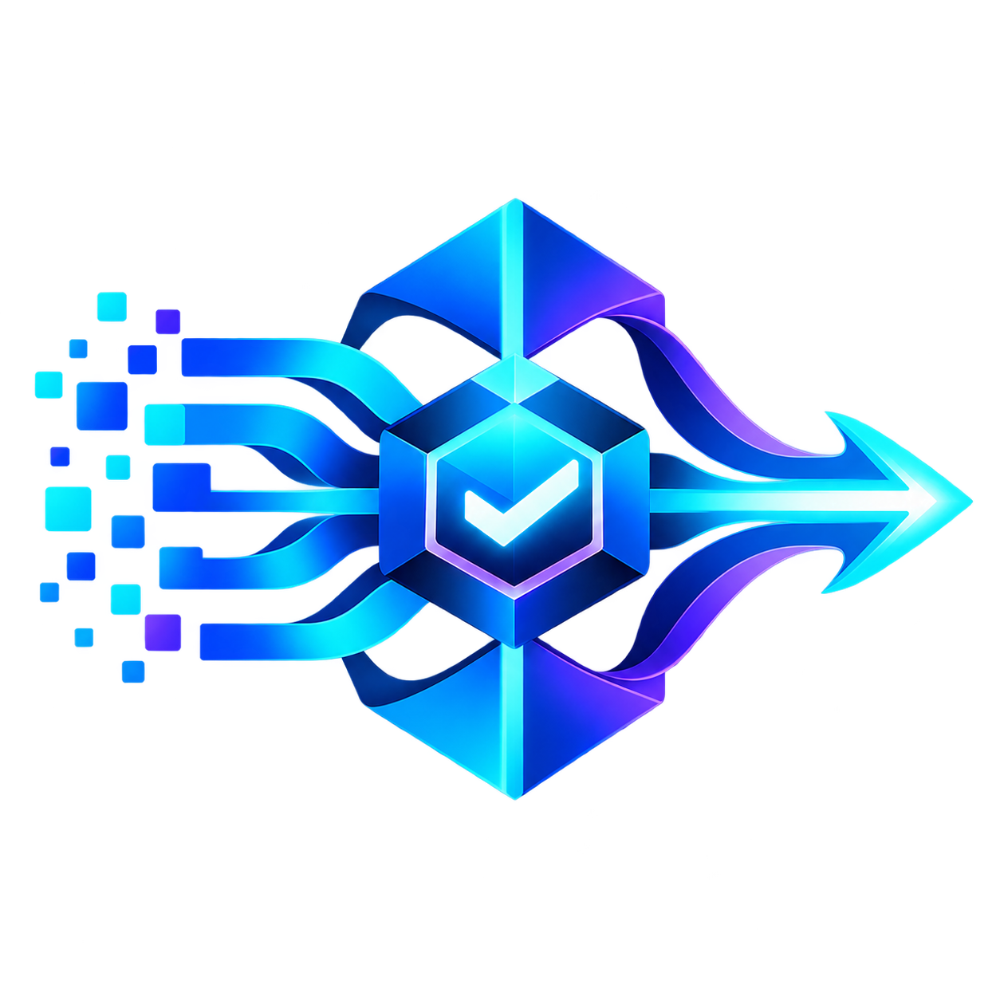
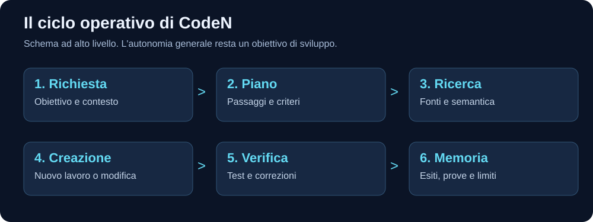
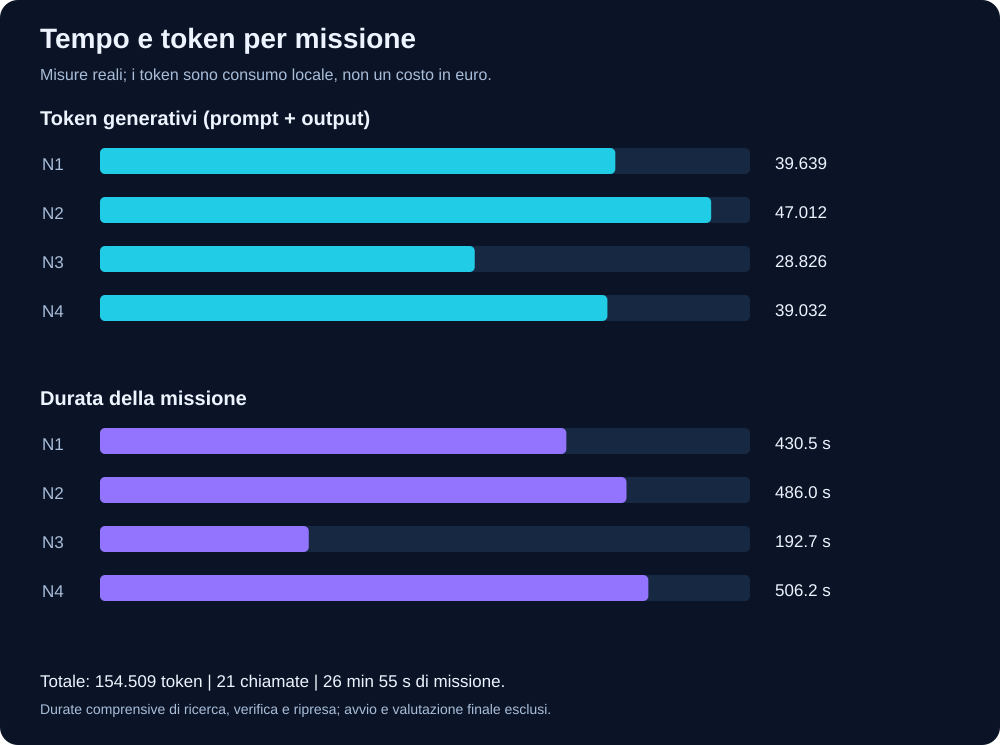
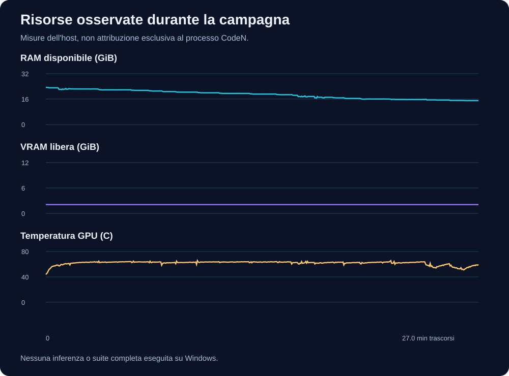
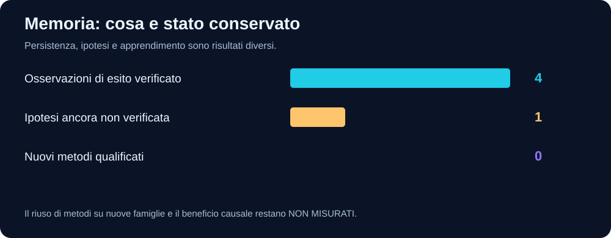

# CodeN Generation

### Dalla richiesta al risultato verificato.

Un progetto AI in sviluppo per cercare informazioni, creare soluzioni, verificarle e conservare esperienze.

**Prototipo proprietario · Sviluppo privato · Vetrina pubblica**

[Capacita e stato](docs/STATO.md) · [Tecnologie](docs/TECNOLOGIE.md) · [Risultati e metodo](docs/METODOLOGIA.md) · [Roadmap](docs/ROADMAP.md)

## Cosa vuole diventare

Un ambiente di lavoro per PC e server che comprende un obiettivo, organizza il lavoro, cerca informazioni, crea, verifica e corregge entro i limiti scelti dall'utente. Modelli e risorse devono essere sostituibili in base al dispositivo e alle esigenze. L'obiettivo comprende memoria di progetto e riuso delle esperienze, oltre la cronologia di una chat.

## Cosa funziona oggi

- **Creazione e riparazione:** programmi creati da zero e bug corretti su missioni controllate.
- **Ricerca documentale e semantica:** fonti pubbliche autorizzate, con embedding locali reali e provenienza registrata.
- **Verifica isolata:** candidati eseguiti in container separati senza rete, con test protetti.
- **Ripresa del lavoro:** una missione ripresa in un nuovo processo conservando candidato, contatori e budget.
- **Memoria persistente:** esiti salvati in uno store autenticato e riaperto fra processi.

Sono capacita osservate nel perimetro delle prove, non una garanzia per qualsiasi richiesta.

## Ultima campagna reale — 18 novembre 2026

**4 missioni su 4 hanno raggiunto i criteri congelati.** Il valutatore separato ha eseguito 17 test di accettazione, tutti passati.

| Missione | Risultato osservato |
|---|---|
| Creazione | Programma per sommare importi CSV e relativa documentazione |
| Riparazione | Gestione corretta dei fusi orari ISO8601 nei casi verificati |
| Riparazione | Parametri URL ripetuti e codifica nei casi verificati |
| Creazione e ripresa | Report dei file, con prosecuzione in un nuovo processo |

Ricerca su documentazione autorizzata, embedding reali e verifica isolata erano attivi. Generazione e valutazione sono rimaste separate. Nessuna ripetizione selettiva delle missioni.

**4/4 non significa affidabilita generale del 100%.** Le missioni sono piccole e controllate. La precedente campagna 3/4 resta registrata come FALLITA; i casi sono diversi e non consentono un confronto diretto di miglioramento.

## Tempi, token e risorse

I token indicano consumo del backend locale, non spesa API in euro. Le durate comprendono ricerca, elaborazione e verifiche della missione; non l'intera preparazione della campagna.

Prova su Unraid/Linux con GPU NVIDIA RTX 3060, modello generativo locale ed embedding locale. Windows usato per orchestrazione leggera; nessuna inferenza o suite completa su Windows. Le misure dell'host comprendono anche altri processi e non rappresentano il consumo esclusivo di CodeN.

## Memoria: cosa e dimostrato

Questa campagna ha conservato **4 osservazioni di esito verificato e 1 ipotesi esplicitamente non verificata**. Lo store e stato riaperto e autenticato. **Nessun nuovo metodo qualificato** e stato prodotto da queste famiglie di compiti.

Il riuso di un metodo era stato osservato in una prova precedente nella sola famiglia dei default mutabili. Apprendimento di metodi su nuove famiglie e beneficio causale della memoria restano NON MISURATI. Salvare un'esperienza non equivale ad addestrare i pesi di un modello.

## Cosa resta da costruire e misurare

- Apprendimento e trasferimento di metodi su famiglie generali di problemi.
- Affidabilita su missioni complesse e su ricerca web aperta.
- Autonomia prolungata, pianificazione continua e orchestrazione distribuita.
- Interfaccia grafica completa e distribuzione finale su PC e server.
- Componenti proprietari appresi e vantaggi misurabili su prove indipendenti.

Brain, MIRA, JEC e Agenti Evolutivi hanno ruoli e livelli di maturita diversi: [stato delle tecnologie](docs/TECNOLOGIE.md). Non presentiamo il progetto come AGI.

## Trasparenza e disponibilita

Questa e una vetrina documentale: **non contiene il codice del prodotto, modelli, eseguibili o pacchetti di installazione**. Il software e sviluppato privatamente e non e distribuito qui. Le immagini e i grafici sono materiali di presentazione.

Le evidenze originali sono conservate privatamente. Pubblichiamo [riepiloghi e dati selezionati](results/campagna-2026-11-18.json), [dati delle missioni](results/missioni-2026-11-18.csv) e [serie delle risorse](results/risorse-2026-11-18.csv). I risultati pubblici non costituiscono una riproduzione indipendente del software privato. La review Code del nuovo delta resta pendente; nessuna release finale e dichiarata.

Aggiornamento: 18 novembre 2026.
