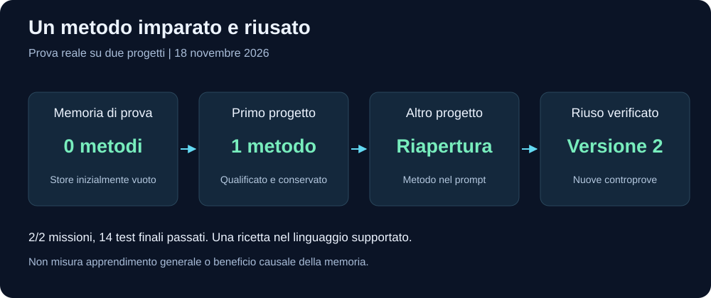
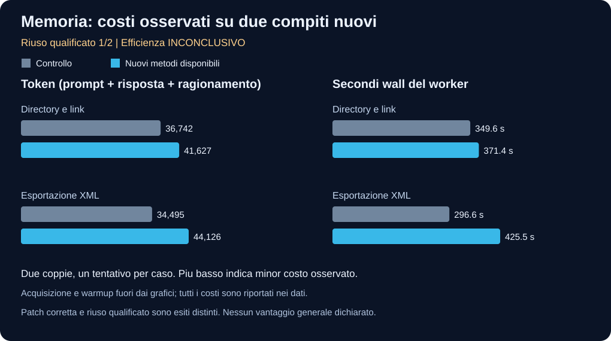

# Capacita e stato

Aggiornamento18novembre2026. VERIFICATO significa osservato nel perimetro dichiarato; NON MISURATO non significa funzionante o fallito.

| Area | Stato | Limite |
|---|---|---|
| Creazione e correzione software | VERIFICATO su missioni controllate | Campagna storica4/4; nuovi candidati non JSON 6/6; non competenza generale |
| Ricerca documentale | VERIFICATO verso fonti autorizzate | Web aperto generale NON MISURATO |
| Recupero semantico | VERIFICATO con embedding reali | Vantaggio causale/qualita generale NON MISURATI |
| Verifica isolata | VERIFICATO su Unraid | Host e daemon fidati;non multi-tenant |
| Ripresa fra processi | VERIFICATO in una missione | Durabilita completa al crash/rollback NON MISURATA |
| Persistenza memoria | VERIFICATO | Osservazioni e ipotesi separate |
| Riuso di metodi | Nuovi metodi non JSON: 2/2 acquisiti, 1/2 riqualificati | Efficienza INCONCLUSIVO; generalizzazione NON MISURATA |
| Autonomia generale24/7 | Da completare | Nessuna affidabilita prolungata dichiarata |
| GUI e distribuzione finale | Da completare | Obiettivo PC/server,non universalita certificata |
| Nuovo modello generalista proprietario | Non addestrato | Componenti appresi ancora da costruire |

La precedente campagna3/4 resta FALLITA. Nuovi compiti4/4 non dimostrano un miglioramento percentuale confrontabile. Il conteggio interno648testLinux0failure0error1skip e Pyright14file0error riguarda verifiche tecniche,non la qualita generale dell'AI. Dopo la suite,solo annotazioni/cast senza effetto operativo,verificati con confronto strutturale e9test mirati;nessuna seconda suite completa.

## Dopo la campagna

Una review indipendente ha individuato un difetto del circuito di recupero non attraversato nel4/4 e due incongruenze di contratto/ripresa. Il delta e stato corretto e verificato offline:652test0failure0error1skip,Pyright15file0error,quattro nuove regressioni. Rilettura Code:nessun blocco individuato nel delta;restano limiti dichiarati. La prova reale4/4 riguarda lo snapshot precedente,non i nuovi byte. Nessuna campagna identica e stata ripetuta per cambiare il risultato.

## Metodi nuovi: verifica successiva offline

Dopo quella campagna, il prototipo ha acquisito e riapplicato ricette parametriche in due nuove famiglie di casi controllati. La memoria cifrata e stata chiusa e riaperta; i metodi recuperati hanno prodotto correzioni su codice diverso, nuovamente verificate. Non sono soltanto osservazioni archiviate.

**VERIFICATO offline con attori controllati:** 13 nuovi controlli; suite finale 665 test, 664 passati, 0 fallimenti, 0 errori, 1 skip motivato. Revisione separata di Code e correzione dei rilievi. Questo era il limite della prova offline. La successiva prova reale descritta sotto ha osservato acquisizione e riuso di un metodo; generalizzazione e beneficio causale rimangono NON MISURATI. La campagna reale 4/4 e i suoi grafici restano invariati.

## Nuova prova reale: un metodo imparato e riusato — 18 novembre 2026

**VERIFICATO in una prova controllata: 2 progetti su 2, 14 test finali passati.**

| Passaggio | Risultato osservato |
|---|---|
| Primo progetto | Il modello corregge una routine JSON; MIRA ricava e qualifica un nuovo metodo |
| Memoria | Il metodo viene cifrato e conservato; un nuovo processo riapre lo store |
| Secondo progetto | Il modello riceve il metodo prima della prima scrittura e corregge una routine diversa |
| Nuova verifica | Test separati e controprove passano; il metodo conserva la prima esperienza e aggiunge la seconda, come versione 2 |

Modello locale reale, ricerca su documentazione ufficiale, embedding reali e verifica isolata erano attivi. La memoria di prova era inizialmente vuota. Input e criteri erano congelati prima della generazione; un tentativo per missione. Il valutatore con i test nascosti e rimasto separato fino alla chiusura della generazione.

**Limite:** una ricetta parametrica nel linguaggio supportato, su due piccole routine JSON. Non dimostra apprendimento generale, addestramento dei pesi o un vantaggio causale della memoria. Il secondo compito ha usato piu tempo e token: questi compiti diversi non sono un confronto controllato di efficienza.

71.940 token e 10 chiamate per le missioni; 105 token e 1 chiamata per il controllo iniziale di decodifica. Totale: **72.045 token, 11 chiamate generative**, piu 18 richieste HTTP di embedding. Tempo sommato delle missioni: **11 min 50 s**, esclusi preparazione e valutazione. Token del backend locale, non una spesa API in euro.

Prova su Unraid: almeno 18,57 GiB di RAM host disponibili, 2,08 GiB di VRAM libera, temperatura GPU massima 66,56 C nei campioni delle missioni. Valori dell'host, non consumo esclusivo del prodotto. Windows usato per orchestrazione leggera; nessuna inferenza o suite completa Windows. [Dati selezionati](../results/metodi-2026-11-18.json).

## Nuova prova non JSON: XML e copia di directory — 18 novembre 2026

**Candidati: 6/6 passano i test finali separati (48 test). Nuovi metodi qualificati: 2/2. Riuso completo: 1/2. Efficienza: INCONCLUSIVO.**

Quattro piccoli progetti di cinque file: esportazione XML e copia di directory con link simbolici, entrambi con interfaccia a riga di comando e componenti protetti. Due acquisizioni, poi due confronti sullo stesso compito con e senza i metodi appena appresi. Ricerca, semantica, modello reale, memoria e verifica isolata restano attivi in entrambi i casi. Un tentativo per missione.

| Compito | Token controllo | Token con metodi | Variazione token | Tempo controllo | Tempo con metodi | Variazione tempo |
|---|---:|---:|---:|---:|---:|---:|
| Directory | 36,742 | 41,627 | +13.3% | 349.6 s | 371.4 s | +6.2% |
| XML | 34,495 | 44,126 | +27.9% | 296.6 s | 425.5 s | +43.5% |

Valori negativi indicano minor costo con memoria. Tempo: avvio del worker fino alla chiusura, inclusi ricerca, modello, verifica e memoria; avvio comune dei modelli, warmup e copia dello store esclusi. I token comprendono prompt, risposte e ragionamento.

**Il riuso e FALLITO; il confronto di efficienza e INCONCLUSIVO.** La soglia richiedeva almeno il 10% in meno su tempo e token, correttezza e riqualificazione del metodo in entrambe le coppie. Patch corrette o una ricetta nel prompt non bastano. I costi osservati non vengono presentati come prova di accelerazione se manca il riuso qualificato.

Costo delle due acquisizioni: 71,914 token e 558.4 s worker, separato dai confronti. Totale delle sei missioni e di tutti i preflight, inclusi due preflight infrastrutturali inconclusivi: **229,273 token/40 chiamate**. I due preflight precedenti non avevano eseguito missioni; errori del controllore conservati e revisionati prima della campagna valida.

Prove pesanti solo su Unraid. Nei campioni: almeno 21.27 GiB RAM host disponibili, 2.08 GiB VRAM libera, massimo 66.28 C GPU. Risorse temporanee della prova archiviate e rimosse. Windows: sola orchestrazione leggera.

**Limiti:** integrazione piu ampia, ma il metodo supportato resta una trasformazione parametrica circoscritta. Due coppie descrittive non dimostrano un vantaggio generale. Nessun addestramento dei pesi o AGI. Prove precedenti e risultati negativi restano conservati. [Dati selezionati e tutti i costi](../results/confronto-metodi-2026-11-18.json).
